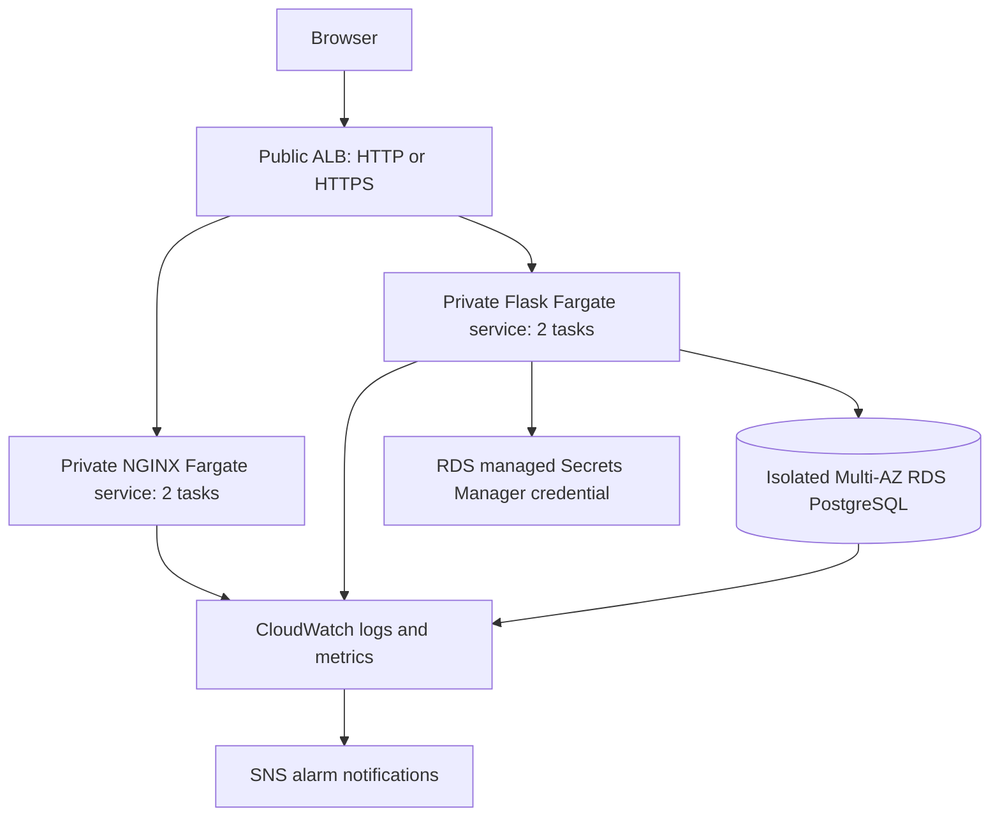

# Containerised Three-Tier AWS Platform

[](https://github.com/Srujal-Y/three-tier-aws-app/actions/workflows/ci.yml)

A three-tier AWS reference platform focused on availability, network isolation, repeatable deployment, and operational recovery. A small task-board application exercises the complete web-to-database path, with NGINX, Flask, and PostgreSQL packaged for local development and ECS Fargate.

The infrastructure uses four reusable Terraform modules: network, database, services, and monitoring. Read the [architecture review](docs/ARCHITECTURE.md) for design decisions, security boundaries, and production considerations, or the [verification record](docs/VERIFICATION.md) for reproducible test evidence.

**Status:** locally verified, with automated CI and credential-free infrastructure policy tests. Live AWS deployment and failover validation remain pending account access.



## Run locally

Install Docker Desktop and start its Linux container engine. From this folder:

```powershell
docker compose up --build -d
python scripts/smoke.py
```

Open http://localhost:8080. Add, complete, and delete tasks. PostgreSQL data survives container restarts in a named volume. `docker compose down` stops the stack; adding `-v` intentionally removes local data. The development password in Compose is only for this local database. No database port is published.

## Deploy to AWS

Requires Terraform >=1.10, AWS CLI v2, Docker, Python, and authenticated AWS credentials with permissions to create the listed infrastructure and IAM roles. Use a dedicated AWS account or environment. This creates billable resources including two NAT gateways, an ALB, four Fargate tasks, and a Multi-AZ RDS instance.

```powershell
aws configure sso
aws sso login --profile YOUR_PROFILE
$env:AWS_PROFILE = "YOUR_PROFILE"
./scripts/deploy.ps1 -Region us-east-1
```

The script creates ECR repositories first (an intentional bootstrap target), builds Linux AMD64 images with a unique immutable release tag, pushes them, creates a reviewable Terraform plan, applies it, waits for ECS stability, and runs a persistence smoke test. Terraform requests approval for the initial repository creation and the script then applies the generated full plan. The script requires an explicit `deploy` confirmation after showing the full plan. Keep the same Name/Environment and Terraform state on subsequent releases. Do not mix the script's TF_VAR inputs with conflicting terraform.tfvars values.

For HTTPS, provision/validate an ACM certificate in the deployment region, point your domain's DNS alias at the ALB, and supply `-CertificateArn ARN -PublicHostname app.example.com`. Access HTTPS through that matching domain. Without a certificate the demo uses HTTP. Add `-AlarmEmail you@example.com` and confirm the SNS subscription email to receive notifications.

For manual deployment, copy `infra/terraform.tfvars.example` to `infra/terraform.tfvars`, fill in image URLs, run `terraform -chdir=infra init`, bootstrap ECR with `terraform -chdir=infra apply -target=module.services.aws_ecr_repository.this`, build/push both images, then run a full plan and apply. Never apply ECS services before their images exist.

## Infrastructure and security

Two AZs each contain a public subnet, private application subnet, and isolated database subnet. Each application subnet uses its own AZ's NAT gateway; database subnets have no internet default route. ECS tasks receive no public IPs. Only ALB traffic reaches the web/API ports; only the API security group reaches PostgreSQL. The web task role has no AWS permissions; the API task role can read only this database's secret. The execution role pulls images and writes logs.

RDS uses encrypted storage, Multi-AZ standby, seven-day backups, PostgreSQL log exports, Performance Insights, deletion protection, and a final snapshot. The API retrieves the RDS-managed secret for each database operation so password rotation does not require task redeployment. Database TLS is required in AWS. The example uses the database owner for its small demo schema; for a production application, use a separate migration identity and grant a dedicated runtime user only the needed table privileges.

Each service runs at least two tasks, scales to four at 65% CPU, uses ALB health checks and a 60-second startup grace period, and enables rollback on failed ECS deployments. `/healthz` checks process liveness; `/api/readyz` also checks database access. Logs retain 30 days. CloudWatch includes Container Insights, a dashboard, ECS CPU/API memory alarms, RDS CPU/storage alarms, and target 5xx alarms, routed to SNS. API responses include generated request IDs; JSON request logs record route, status, and duration without request bodies. Payloads are limited to 4 KiB, database statements and locks to five seconds, and API responses disable caching.

The demo has no user authentication: anyone with access to the ALB can edit tasks. Add authentication and access policy before using it for private data. Subnet CIDRs and two-AZ sizing are intentionally fixed in the network module; deploy separate environments in separate VPCs and state files.

## Validation

```powershell
python -m venv .venv
./.venv/Scripts/python -m pip install -r app/api/requirements.txt
./.venv/Scripts/python -m unittest discover -s tests -v
terraform -chdir=infra init -backend=false
terraform -chdir=infra fmt -check -recursive
terraform -chdir=infra validate
terraform -chdir=infra test
docker compose config --quiet
python scripts/smoke.py http://localhost:8080
python scripts/resilience.py
```

GitHub Actions runs API tests, Terraform validation, Docker builds, and a real PostgreSQL CRUD smoke test. Unit tests cover invalid input, SQL parameter binding, missing records, and database failure behavior. The smoke test checks actual persistence and removes its test record.

Local verification passed all nine API unit tests, Terraform provider validation and formatting, Compose configuration validation, both Docker image builds, and the PostgreSQL integration smoke test (readiness, create, read, update, delete). All four local containers started successfully, and the web page returned HTTP 200. AWS deployment and AWS runtime behavior remain unverified because account credentials are not configured.

## Operations

Start with `docs/OPERATIONS.md` for diagnosis, state storage, backup recovery, and cleanup. Commit `.terraform.lock.hcl`; exclude local state, plan files, credentials, and tfvars. This repository defaults to local Terraform state so it needs no pre-existing account resources; use encrypted remote state with locking before team deployment.

References: [ECS ALB health checks](https://docs.aws.amazon.com/AmazonECS/latest/developerguide/load-balancer-healthcheck.html), [RDS-managed passwords](https://docs.aws.amazon.com/AmazonRDS/latest/UserGuide/rds-secrets-manager.html).
